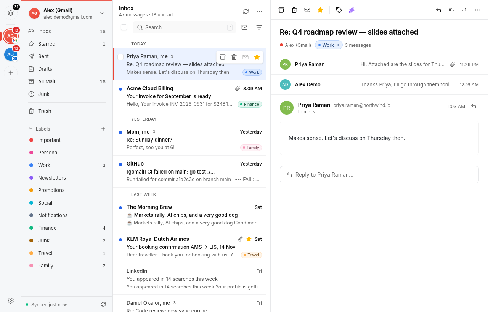
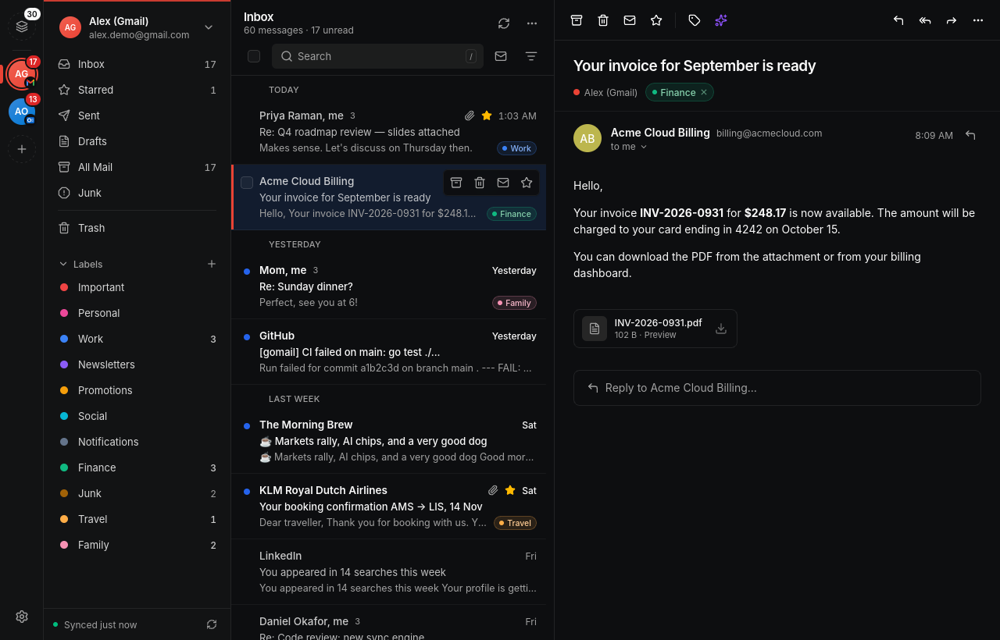
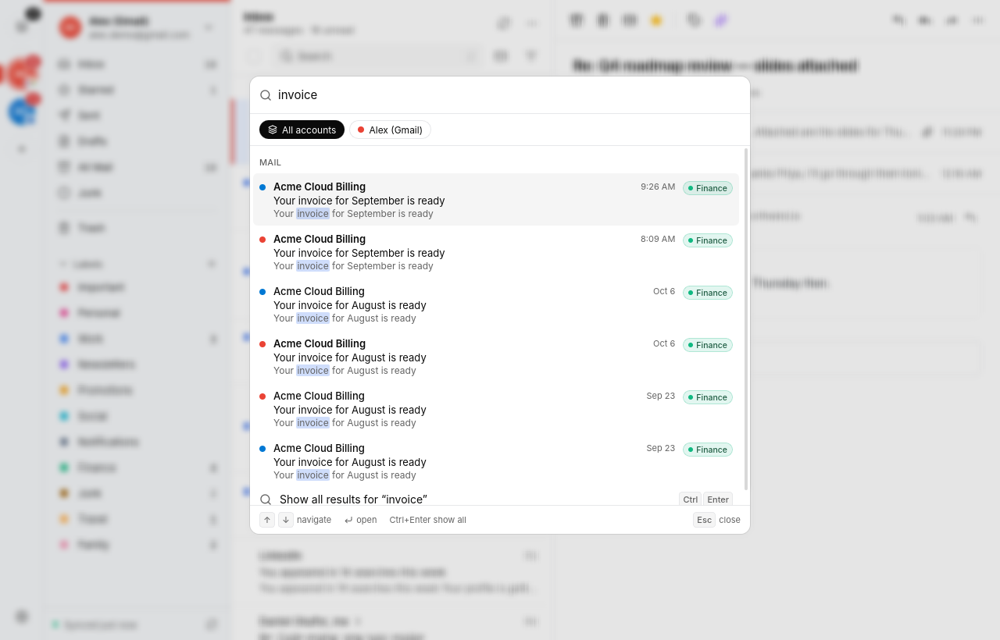
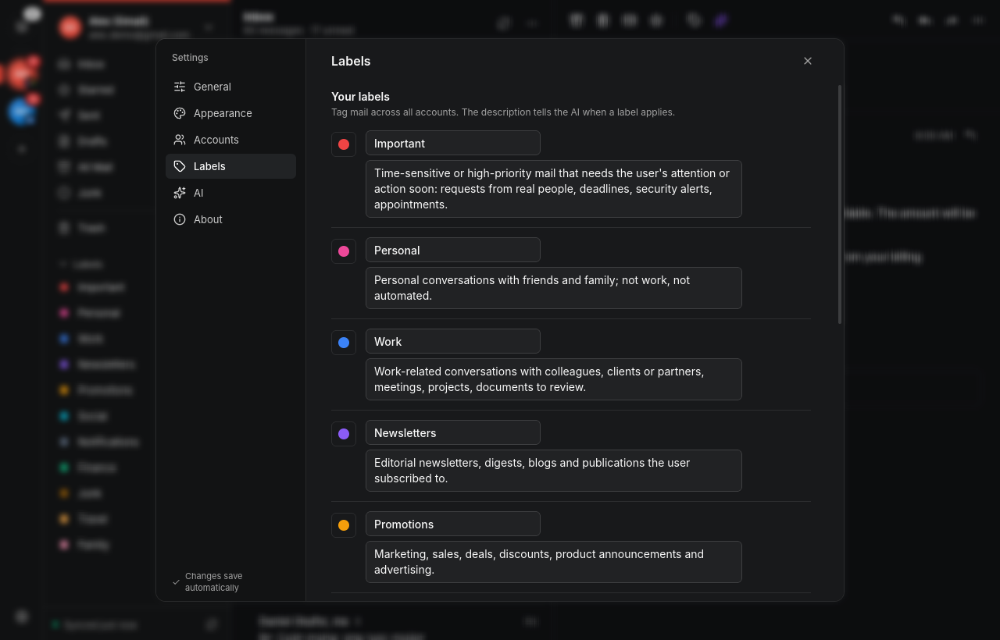
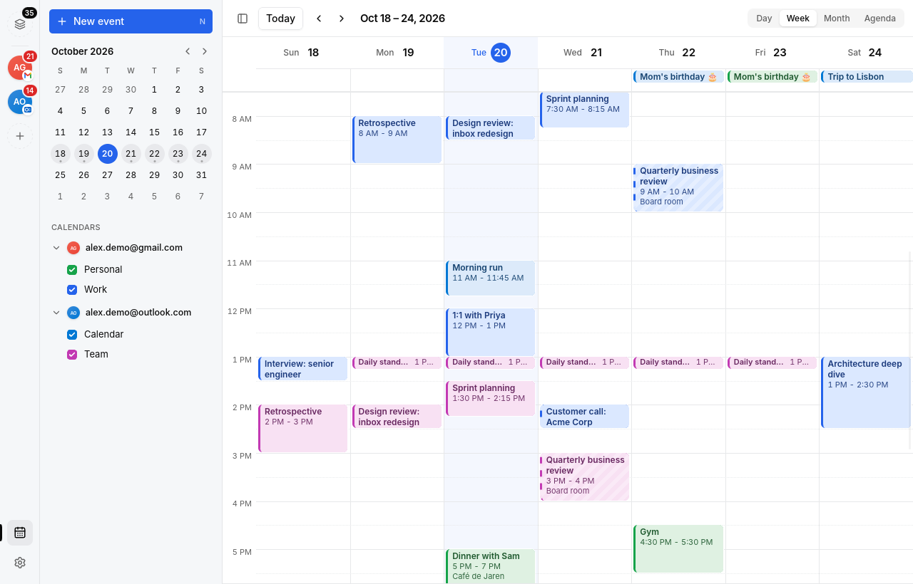

# gomail

A calm, fast desktop mail client for **Gmail** and **Outlook / Microsoft 365**, built around labels.
You define labels in plain language and the **Jev** decision model (through OpenRouter) sorts your mail into them.
It runs natively on Linux, macOS and Windows.



## Features

- **Labels first.** Every mailbox has its own labels and rules (its settings page → Labels & rules); the unified inbox shows labels with the same name as one. Each label has a short description ("invoices, receipts and bank statements") that tells the AI when it applies. Gmail labels and Outlook categories are imported too, and you can export and import label sets as JSON.
- **AI labeling with Jev.** Label one message, a whole folder or all your mail, with a cost estimate, a daily budget and a cancel button. New mail can be labeled automatically. AI is optional, and mail is only sent to the model when you label or improve something.
- **Per-mailbox views.** Unified inboxes or one account at a time, conversation view, multi-select label filters remembered per folder, and an "Unread" toggle.
- **One calendar for every mailbox.** Google and Outlook calendars side by side in day, week, month and agenda views (`g c` opens it). Show or hide calendars with checkboxes (Alt/Option-click shows only one); right-click a mailbox to disable its calendar, mute its reminders or sync it now. Create events by clicking or dragging, move and resize them with Undo, add a Google Meet or Teams meeting with one switch (or paste any Zoom/Webex link), and handle recurring events with "this event / all events". RSVP to invitations right from the email, see an event's original time when it was scheduled in another time zone, and get desktop reminders that open the event. Fully usable from the keyboard.
- **Search everywhere with ⌘K / Ctrl+K.** One palette for mail search across all accounts (with `from:`, `label:`, `is:unread`, `has:attachment` and `in:` operators), jumping to folders, toggling labels and running commands.
- **Writing.** Rich text, signatures per account, contact autocomplete, attachments, drafts that sync to the server, undo send, and AI grammar help that keeps your tone (right-click in the editor).
- **Reading.** Safe sandboxed HTML rendering, remote images blocked until you allow them, one-click unsubscribe, attachment previews, and simple emails rendered in dark colors in dark mode.
- **Made for the keyboard.** j/k, e, #, r, a, f, l in mail; t, d/w/m/a, arrows and ↑/↓ between events in the calendar. Press `?` for the full list.
- **Yours to style.** Light, dark or system theme, accent color, corner radius, compact density, text size and an optional single-pane layout.
- **Private by design.** Your own OAuth app, tokens in the OS keychain, and everything stored locally in SQLite.
- **Sync between computers.** Turn on sync in Settings → Sync and enter the 24-word sync code on your other computers: settings, mailboxes, labels, rules and label decisions stay the same everywhere, end-to-end encrypted. Use the default server or [host your own](deploy/sync/README.md).

| Dark mode | Command palette | Labels |
|---|---|---|
|  |  |  |



## Install

Download the latest build for your system from [GitHub Releases](https://github.com/AVMG20/gomail/releases/latest).

| OS | Files |
|---|---|
| **Linux** | `.AppImage` (any distro), `.deb`, `.rpm` or `.tar.gz` |
| **macOS** | universal `.dmg` or `.zip` (Apple Silicon and Intel) |
| **Windows** | setup installer or portable `.exe` |

**macOS: the app is not signed yet.** Gatekeeper will say gomail "can't be opened". Either right-click gomail in Applications and choose **Open**, then **Open** again, or run:

```sh
xattr -dr com.apple.quarantine /Applications/gomail.app
```

**Linux:** for the AppImage, `chmod +x gomail-*.AppImage`. It needs WebKitGTK 6 (`libwebkitgtk-6.0`), which current GNOME-based distros ship.

## First run

A short welcome guide walks you through three steps. You can skip it, and reopen it later from **Settings → About**.

1. **Connect a mailbox.** gomail signs in with *your own* OAuth app, so your tokens never pass through a third party. This is a one-time setup of a few minutes:
   - Gmail: [create a Google OAuth client](docs/BACKEND.md#creating-a-google-oauth-client-gmail)
   - Outlook / Microsoft 365: [create a Microsoft app registration](docs/BACKEND.md#creating-a-microsoft-app-registration-outlook--microsoft-365)

   Paste the client ID into **Settings → Accounts**, then click **Add account**.
2. **AI labeling (optional).** Add an [OpenRouter](https://openrouter.ai/keys) API key in **Settings → AI**. Labeling uses Jev (`typesafe/jev-1.13`), and grammar help uses a chat model of your choice. See [OpenRouter setup](docs/BACKEND.md#openrouter).
3. **Pick starter labels**, or write your own. Good descriptions make better labels.

### Try it without an account

Demo mode starts gomail with two seeded mailboxes, a Gmail-like one and an Outlook-like one, and never touches real accounts:

```sh
GOMAIL_DEMO=1 gomail          # Windows (PowerShell): $env:GOMAIL_DEMO=1; .\gomail.exe
```

More in [docs/BACKEND.md](docs/BACKEND.md#demo-mode).

## Build from source

Requirements:

- [Go 1.26](https://go.dev/dl/)
- [Node.js 22](https://nodejs.org/)
- the Wails 3 CLI: `go install github.com/wailsapp/wails/v3/cmd/wails3@v3.0.0-beta.33`
- **Linux only:** GTK 4 and WebKitGTK 6 headers, e.g. on Debian/Ubuntu: `sudo apt install libgtk-4-dev libwebkitgtk-6.0-dev`
- **Windows:** WebView2, which comes with Windows 10/11
- **macOS:** Xcode command-line tools

```sh
git clone https://github.com/AVMG20/gomail
cd gomail
wails3 task build        # or a platform task: wails3 task linux:build
./bin/gomail
```

## Development

```sh
wails3 dev                       # the real app with hot reload (GOMAIL_DEMO=1 for demo data)
cd frontend && npm run dev       # the UI alone in a browser, against an in-memory mock backend
cd frontend && npm test          # frontend unit tests (Vitest)
go test ./...                    # backend tests, including end-to-end tests against fake Gmail/Graph/OpenRouter servers
```

- The frontend (Vue 3, shadcn-vue, Tailwind 4) lives in `frontend/`. Everything that talks to the backend goes through `frontend/src/lib/api.ts`.
- Mock mode supports `?stress=1` (20,000 messages), `?reauth=1` and `?update=1` for testing edge cases.
- After changing the Go service or models, regenerate the bindings: `wails3 generate bindings -clean=true -ts -i`.
- The architecture, data directory, environment variables and troubleshooting are covered in [docs/BACKEND.md](docs/BACKEND.md).

## Releasing

Tagged releases are built for all three platforms by GitHub Actions. See [docs/RELEASING.md](docs/RELEASING.md).
